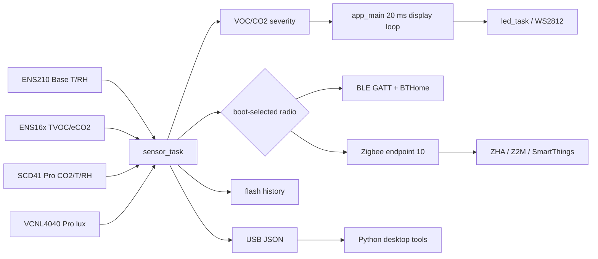

# Architecture

## System overview

AirCube is a USB-powered ESP32-H2 sensor appliance. Firmware reads I2C environmental sensors, computes a canonical 0-500 VOC Level, stores five-minute summaries in flash, renders air quality on WS2812 LEDs, emits USB JSON, and runs exactly one radio stack per boot: BLE by default or Zigbee when joined/pairing. Python desktop tools consume USB data; ZHA, Zigbee2MQTT, and SmartThings consume Zigbee reports.

## Major components

| Component | Responsibility | Primary paths/symbols |
|---|---|---|
| Firmware orchestration | Initialization, sensor/command tasks, display loop | `firmware/main/main.c`: `app_main`, `sensor_task`, `command_task` |
| Sensors/model | Shared I2C, Base sensors, optional Pro sensors, model detection | `i2c_driver.c`, `ens210.c`, `ens16x_driver.c`, `scd41.c`, `vcnl4040.c`, `device_model.c` |
| Local UI | WS2812 rendering, color mapping, brightness, button, auto-dim | `led.c`, `led_color_lib.c`, `ws2812_control.c`, `button.c`, `auto_dim.c` |
| Storage | Seven-day flash ring of five-minute summaries | `history.c`, `history.h`, `partitions_zigbee.csv` |
| USB | Periodic JSON and command/history interface | `serial_protocol.c` |
| Radio | NVS-backed BLE/Zigbee selection and transitions | `radio_mode.c`, `ble_gatt.c`, `zigbee.c` |
| Desktop | Live GUI, history export, logging/replay/plotting | `scripts/` |
| Hub integrations | Convert Zigbee endpoint 10 into platform entities | `zha/`, `z2m/`, `smartthings/` |
| Hardware/enclosure | PCB source/manufacturing and printable enclosure artifacts | `kicad/`, `mechanical/` |

## Execution and data flow

`app_main()` initializes power management, NVS, I2C, serial, LED/history/button, all sensor drivers, model detection, auto-dim, and radio mode. It starts `sensor_task` and `command_task`, while remaining in a 20 ms color/pairing animation loop. Other tasks are `led_task`, `button_task`, mode-dependent `zigbee_main` or NimBLE host work, and on-demand `ble_hist_stream`.

## Variants and boundaries

| Behavior | Base | Pro |
|---|---|---|
| Temperature/humidity | ENS210; reported temperature gets -2 C software correction | SCD41 with sensor offset and software trim |
| Gas | ENS16x eCO2/eTVOC/VOC Level | Same, compensated using SCD41 T/RH |
| True CO2/lux | Zero/absent | SCD41 CO2 and VCNL4040 lux |
| LED severity | VOC Level | max(VOC Level, CO2 Level) |
| Auto-dim | Disabled | VCNL4040 hysteresis policy |
| History CO2 field | eCO2 | true CO2 |

`aircube_model_detect()` marks Pro when either optional sensor responds. This is verified source behavior, not proof that partially populated/failing Pro units behave safely; see [known issues](known_issues.md). Current KiCad/BOM files show only ENS161/ENS210 and do not explain the Pro sensor wiring.

Communication boundaries are intentionally distinct:

- USB serial remains active in both radio modes.
- BLE and Zigbee do not run concurrently. NVS flags and reboot move a default BLE device into Zigbee pairing; failed factory-new steering or network removal returns it to BLE.
- Hub integrations implement only the common Zigbee fields; Pro CO2 and illuminance are currently firmware-only Zigbee clusters.
- Flash history has no RTC timestamps. Clients infer wall time by anchoring the newest slot at retrieval time.

Detailed contracts: [protocols and integrations](protocols_and_integrations.md), [BLE GATT](BLE_GATT_PROTOCOL.md), [build and test](build_and_test.md), [hardware and tools](hardware_and_tools.md), and [known issues](known_issues.md).

## Sensor acquisition and processing

The shared bus is I2C0 at 100 kHz on GPIO 1 SDA/GPIO 0 SCL (`i2c_driver.c`). ENS210 is address `0x43`; ENS16x `0x52`; SCD41 `0x62`; VCNL4040 `0x60`.

`sensor_task` reads on the configurable 100-10000 ms period. ENS16x produces eTVOC/eCO2 and AQI-UBA. `main.c` maps TVOC through fixed band edges 65/220/650/2200/5500 ppb to canonical VOC Level 15/50/100/200/500. Deprecated AQI-S is retained as zero. The SCD4x runs in periodic measurement mode, producing a sample every ~5 s; `scd41_poll()` polls the sensor's data-ready flag (`get_data_ready_status`, 0xE4B8) at most once per second and reads only when a new sample is ready, so each sample is consumed exactly once and the sensor's default 5 s cadence is preserved. The ENS210 is sampled at the same ~5 s cadence in the datasheet-recommended single-shot mode: trigger via `SENS_START` (0x03), await completion via `SENS_STAT`, then read and CRC-7 validate both values; low power is enabled so the sensor returns to standby between conversions. Its Zigbee comparison attributes `0x0006`/`0x0007` on custom cluster `0xFC01` are signed/unsigned integer hundredths; `zha/aircube.py` divides both by 100 for engineering-unit display. VCNL4040 lux is calibrated and adjusted for estimated LED spill.

For Zigbee reporting, `sensor_ema.c` maintains **separate 30-second time-constant EMA state** for SCD4x (CO2, temperature, humidity) and ENS210 (comparison/fallback temperature and humidity). Only a newly validated sensor measurement advances its filter: `alpha = 1 - exp(-elapsed_seconds / 30)`, approximately 0.154 for a five-second interval. The first valid measurement starts at its actual value; startup zeros and failed/repeated reads are not filtered. `main.c` forwards the filtered values to Zigbee about every 10 seconds; the USB serial JSON and LED CO2 severity still use the raw values. An absent SCD4x uses the independently filtered ENS210 temperature/humidity as the Zigbee fallback (CO2 remains unavailable). Sensor reporting waits until a valid primary measurement is available.

The app display loop maps the worse applicable 0-500 level to green through red. `led_task` owns physical output and intensity ramping; `led.c` protects LED state with a mutex. A short GPIO 11 button press cycles 0/10/30/60/100 percent; a three-second press invokes Zigbee pairing. Pro auto-dim changes effective output without changing reported/configured brightness.

## Storage and shared state

The custom `history` partition contains packed 32-byte `history_slot_t` records. RAM aggregation flushes average/min/max temperature, humidity, VOC Level, CO2/eCO2, and TVOC every five minutes. Logical capacity is 2016 records (seven days); extra physical slots support sector erasure. Mutexes protect LED state, readout period, and most history operations, but not all cross-task compound state. Consult known issues before changing concurrency.

## External frameworks and dependencies

- ESP-IDF `>=5.0.0`, target ESP32-H2.
- Espressif `esp-zboss-lib ==1.6.4` and `esp-zigbee-lib ==1.6.7`; source comments avoid Zigbee `1.6.8` due to a PHY startup hang.
- ESP-IDF NimBLE for BLE GATT.
- Python desktop: PySerial, Matplotlib, PyQt6; PyInstaller optional.
- Home Assistant zigpy/ZHA, Zigbee2MQTT converter APIs, and SmartThings Edge APIs are external runtime boundaries and are not vendored.
